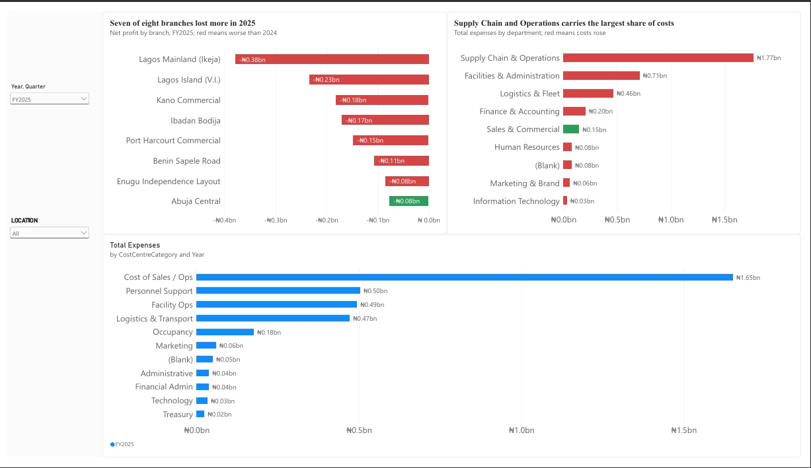
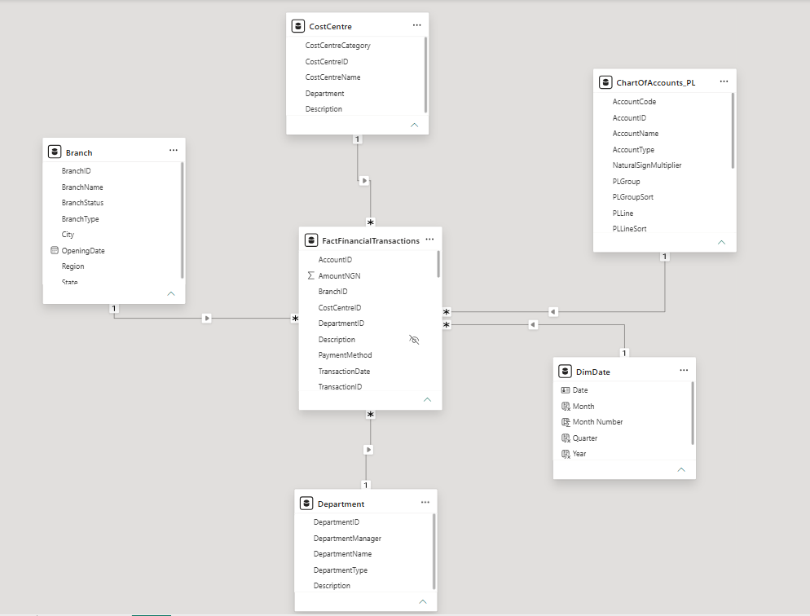

# Finsight-Financial-Analytics-Powerbi
A Power BI financial reporting solution for a Nigerian FMCG distributor. Built as a class case study in data modelling, DAX and financial reporting.
# Project Overview
FinSight Distribution & Consumer Products Ltd. operates across eight branches in Nigeria. Between 2024 and 2025 its revenue grew sharply, but profit did not follow. The Managing Director asked why.The brief called for an automated P&L, a 2024 vs 2025 comparison, the main cost drivers, a branch and department efficiency review, and recommendations for leadership.
## Headline finding
Revenue rose 52.6%, from ₦1.41bn to ₦2.15bn. Total expenses rose 68.1%, from ₦2.10bn to ₦3.54bn. The net loss before tax doubled, from ₦691m to ₦1.38bn.
Product cost was not the cause. Cost of goods sold grew 37.6%, slower than revenue. The squeeze came from diesel, freight and import costs, which grew between 135% and 190%.
## Dashboard Preview


Overview
___

Profit and Loss statement
___

Revenue, margin trends and Expense breakdown
___

Month on Month Revenue
___

Branch and Department performance
___
## Data
The dataset comes from the Project file. Amounts are in Nigerian naira (NGN), covering January 2024 to December 2025.

| **Table** |	**Rows** |	**Role** |
|---|---| --- |
| FactFinancialTransactions |	4,500 |	Fact table with one row per ledger posting |
| DimAccount |	38 |	Chart of accounts and P&L layout |
| DimDepartment |	10 |	Corporate departments |
| DimBranch |	8	| Branch locations |
| DimCostCentre |	12 |	Functional cost pools |
| DimDate |	built in DAX |	Calendar table for time intelligence |

## Data model
A star schema with the fact table in the centre. Each dimension joins to the fact table one-to-many, with a single filter direction. The date table is created in DAX and joined on TransactionDate.


## Cleaning steps
- Converted TransactionDate from text to date.
- Replaced 96 blank DepartmentID and 58 blank CostCentreID values with "Unassigned", and added matching rows to the dimensions so these transactions stay in the totals.
- Checked eight repeated transaction references. Each pair has a different date and amount, so all rows were kept.
- Removed the duplicate chart of accounts table and trimmed DimAccount to the columns the P&L uses.
- Confirmed that every debit and credit flag matches its account's normal balance. Amounts are all positive, so the sign logic lives in the measures.

## Key measures
Revenue, cost of sales, operating expenses, total expenses, gross, operating and net profit, three margins, prior-year and YoY versions of each, and a month-on-month revenue measure. The full list with DAX is available in [Measures](Documents/measures.md).

## Findings
- Margins fell at every level. Gross margin dropped from 16.7% to 11.7%, and net margin from -49.0% to -63.9%.
- Diesel and fuel rose 183%, inbound freight 185%, outbound freight 190% and importation and customs 135%.
- Operating expenses rose 78%, about 25 points faster than revenue.
- Seven of eight branches lost more than in 2024. Lagos Mainland had the largest swing, from a ₦132m loss to ₦378m. Abuja Central was the only branch that improved.
- Monthly revenue swung between -34% and +63% in 2025.

## Recommendations
1. Cut energy costs. Buy fuel in bulk, service generators on a schedule, and add solar or hybrid power at the highest-use branches.
2. Renegotiate freight and import costs. Tender haulage contracts, consolidate shipments, review clearing agents and stock regional hubs. Had these lines grown only in line with revenue, FY2025 costs would have been about ₦0.57bn lower.
3. Put the loss-making branches on a cost and pricing plan. Start with Lagos Mainland, Lagos Island, Ibadan and Kano.
The full write-up is in [Management Naarative](Documents/management-narrative.md).

## Tools
1. Power BI Desktop
2. Power Query
3. DAX

## Repository contents

```
Finsight-Financial-Analytics/
├── README.md
├── report/
│   ├── FinSight_Dashboard.pbix
│   └── FinSight_Dashboard.pdf
├── images/
├── docs/
│   ├── measures.md
│   └── management-narrative.md
└── data/
```
## How to open the report
Download the .pbix file from the report folder and open it in Power BI Desktop. A PDF export is included for a quick look without Power BI.

## About
Built by [Adelowo David O.] as part of a data analysis course.
