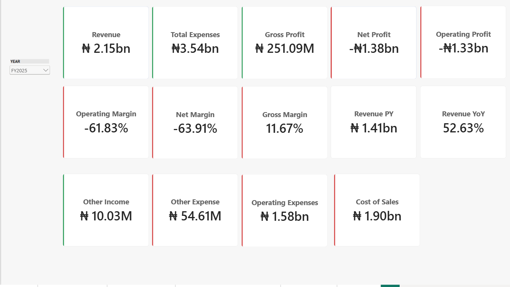
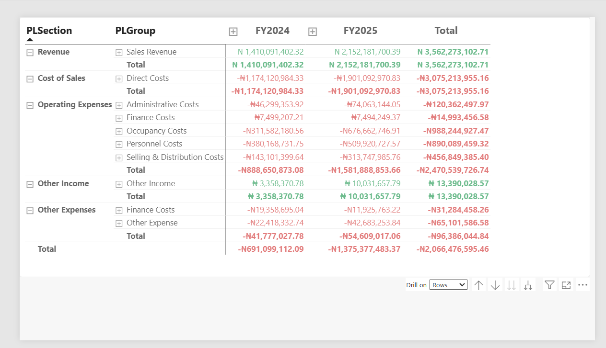
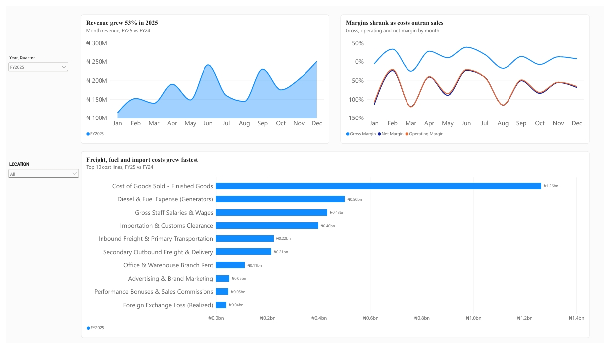
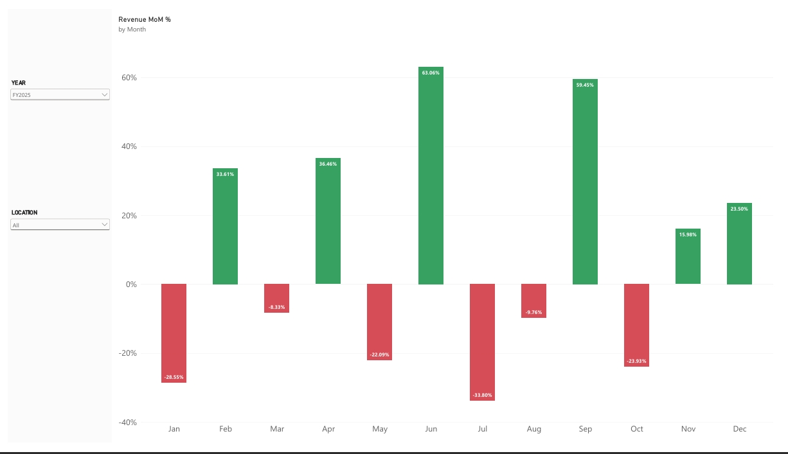

# Finsight-Financial-Analytics-Powerbi
A Power BI financial reporting solution for a Nigerian FMCG distributor. Built as a class case study in data modelling, DAX and financial reporting.
# Project Overview
FinSight Distribution & Consumer Products Ltd. operates across eight branches in Nigeria. Between 2024 and 2025 its revenue grew sharply, but profit did not follow. The Managing Director asked why.The brief called for an automated P&L, a 2024 vs 2025 comparison, the main cost drivers, a branch and department efficiency review, and recommendations for leadership.
## Headline finding
Revenue rose 52.6%, from ₦1.41bn to ₦2.15bn. Total expenses rose 68.1%, from ₦2.10bn to ₦3.54bn. The net loss before tax doubled, from ₦691m to ₦1.38bn.
Product cost was not the cause. Cost of goods sold grew 37.6%, slower than revenue. The squeeze came from diesel, freight and import costs, which grew between 135% and 190%.
## Dashboard Preview

Overview
___

Profit and Loss statement
___

Revenue, margin trends and Expense breakdown
___

Month on Month Revenue
___

Branch and Department performance
___
## Data
The dataset comes from the Project file. Amounts are in Nigerian naira (NGN), covering January 2024 to December 2025.

| **Table** |	**Rows** |	**Role** |
|---|---| --- |
| FactFinancialTransactions |	4,500 |	Fact table with one row per ledger posting |
| DimAccount |	38 |	Chart of accounts and P&L layout |
| DimDepartment |	10 |	Corporate departments |
| DimBranch |	8	| Branch locations |
| DimCostCentre |	12 |	Functional cost pools |
| DimDate |	built in DAX |	Calendar table for time intelligence |

## Data model
A star schema with the fact table in the centre. Each dimension joins to the fact table one-to-many, with a single filter direction. The date table is created in DAX and joined on TransactionDate.
